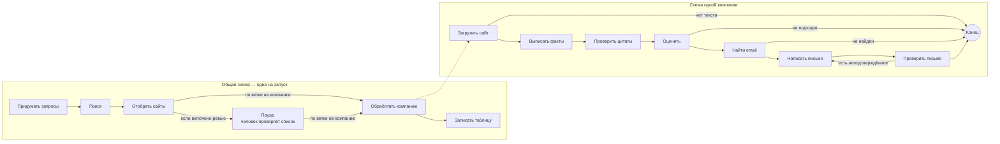

# leadgen — ИИ-агент лидогенерации на LangGraph

**Из одного абзаца «кого мы ищем» — в таблицу готовых лидов.** Агент сам придумывает
поисковые запросы, находит сайты компаний, выписывает с них факты, оценивает каждую
компанию по критериям, находит рабочий email и пишет черновик первого письма.
Результат — таблица `out.csv`, одна строка на компанию. Письма никуда не отправляются:
их читает и отправляет человек.

Главное правило — **агент не придумывает факты о компаниях**. Каждый факт хранится
вместе с адресом страницы и дословной цитатой с неё, и цитату проверяет программа,
а не просьба к модели. Если в письме есть утверждение, которое ничем не подтверждено,
письмо переписывается или помечается для ручной правки.

### Техническая часть коротко

- **Каркас агента — LangGraph.** Работа описана как схема из шагов со стрелками между
  ними. Есть общая схема на весь запуск и отдельная маленькая схема для одной компании.
  Компании обрабатываются одновременно, по несколько штук, и не мешают друг другу:
  каждая работает со своими данными, а результаты в конце собираются в одну таблицу.
- **Продолжение после сбоя.** После каждого шага LangGraph сохраняет прогресс в файл базы
  данных. Если прогон упал или упёрся в лимит, он продолжается с того шага, где
  остановился, и не платит второй раз за уже сделанную работу.
- **Человек принимает решение посередине.** После поиска агент останавливается и
  показывает найденные сайты, человек вычёркивает лишние. Остановка тоже сохраняется:
  можно закрыть терминал и вернуться завтра.
- **Модель — Claude по подписке, без платного доступа к API.** Модель отвечает строго
  в заданном формате, повторные одинаковые вопросы берутся из сохранённых ответов,
  расход считается в количестве обращений к модели.
- **Качество проверяет программа.** Отдельные шаги сверяют цитаты со страницами и письмо
  с фактами, а для оценки качества есть набор вручную размеченных компаний и журнал
  улучшения подсказок модели.

2 схемы · 13 шагов · компании обрабатываются одновременно · продолжение после сбоя · пауза на решение человека · 24 теста.

---

## Что реализовано

| Модуль | Что делает |
| --- | --- |
| **Подготовка поиска** | Модель превращает описание клиента в поисковые запросы — теми словами, которыми компании пишут о себе. |
| **Поиск и отбор сайтов** | Поиск через Tavily, из ссылок оставляются сайты компаний, отсекаются СМИ, каталоги и маркетплейсы, затем — пауза, чтобы человек просмотрел список. |
| **Сбор сайта** | Главная, «о компании», «услуги», «контакты» — по ссылкам с главной, а не угадыванием адресов. Если сайт запрещает автоматический обход, агент его не трогает. |
| **Факты с источником** | Модель выписывает факты вместе с адресом страницы и дословной цитатой. Программа ищет цитату на странице; не нашла — факт выбрасывается. |
| **Оценка компании** | Четыре критерия, по каждому — объяснение и оценка от 0 до 3. Набрала мало баллов или нет признаков, что ей нужно наше предложение, — компания отсеивается. |
| **Email** | Сначала общие адреса с сайта (`info@`, `sales@`), потом сервис Hunter. Неподтверждённый адрес помечается как неуверенный. |
| **Черновик и его проверка** | Письмо опирается только на проверенные факты. Модель выписывает из письма все утверждения о компании, программа сверяет их с цитатами. Есть неподтверждённое — одна попытка переписать. |
| **Лимит и продолжение** | Ограничение числа обращений к модели за запуск: при достижении прогон останавливается аккуратно, а не падает, и его можно продолжить. |
| **Оценка качества** | 20 вручную размеченных компаний, подсчёт метрик, журнал правок подсказок «было / стало». |

---

## Разработка с ИИ

Код проекта написан Claude Code. Моя часть — спецификация, разбиение на этапы, решения
по устройству и данным, приёмка каждого этапа и разметка проверочного набора.

### Этапы с приёмкой

Проект собран за 8 этапов. Каждый опирается на предыдущий и добавляет **не больше одного
нового внешнего сервиса или библиотеки** — чтобы при сбое было понятно, кто виноват:

```text
1–3  каркас и обе схемы — на заготовленных сайтах и поддельной модели
4    настоящие источники: поиск, сайты, запреты обхода, Hunter, сохранение страниц
5    настоящая модель через Claude Code, сохранение ответов, LangSmith
6    сохранение прогресса, повторы при сбоях, лимит, продолжение
7    проверки качества: цитаты и письмо
8    пауза на решение человека, проверочный набор, доводка подсказок, прогон на 50
```

Этап считается закрытым, только если команда приёмки из [stages/](stages/) запущена и вывод
совпал с ожидаемым. Итог каждого этапа записывается в [PROGRESS.md](PROGRESS.md): что
сделано, какие решения приняты и почему, что осталось. Новая сессия ИИ узнаёт о прошлых
этапах только оттуда.

### Инструкции для ИИ

- **[CLAUDE.md](CLAUDE.md)** — команды, где что лежит, и правила, которые нельзя нарушать:
  факт хранится только вместе с адресом страницы и цитатой; общие адреса вроде `info@`
  важнее личных; сайт, запретивший обход, не трогаем; спецификацию меняем только с моего
  согласия.
- **[.claude/rules/graph-code.md](.claude/rules/graph-code.md)** — правила для кода схем.
  Подключаются только тогда, когда ИИ правит эти файлы, и не засоряют ему контекст
  в остальное время.
- **Команда `/stage N`** — один и тот же порядок для каждого этапа: прочитать задание
  и журнал, нужные разделы спецификации, сделать, прогнать приёмку, записать итог.
- **[SPEC.md](SPEC.md)** — спецификация первой версии. Каждое отступление от неё записано
  в журнале вместе с причиной.

### Как велась работа

- **Сначала заготовки.** Первые три этапа работают на сохранённых сайтах и поддельной
  модели. Этот режим остался: `--offline` проверяет весь агент без интернета и без расхода лимита.
- **Проверяет программа, а не просьба к модели.** Есть ли цитата на странице, подтверждено
  ли утверждение письма, общий это адрес или личный — решает код. Модель только находит
  и формулирует.
- **Замеры вместо «на глаз».** Каждая правка подсказки модели — одна за раз, с замером
  «было / стало» на размеченном наборе. Разметка делается по сайту компании, а не по оценке
  агента, — иначе замер показывал бы согласие агента с самим собой.
- **Честные пометки.** То, что не удалось проверить вживую (например, реакцию на исчерпание
  лимита подписки), так и записано в журнале.

---

## LangGraph: как устроен агент

LangGraph здесь — не обёртка над запросом к модели, а каркас всего процесса: в каком
порядке идут шаги, куда свернуть после каждого, что делать одновременно, как сохранить
прогресс и продолжить, где остановиться и подождать человека. Модель вызывается внутри
отдельных шагов, как обычная функция.

### Две схемы



- **Общая схема** ([leadgen/graph/outer.py](leadgen/graph/outer.py)) работает одна на весь
  запуск: придумывает запросы, ищет, отбирает сайты, раздаёт компании на обработку
  и в конце записывает таблицу.
- **Схема одной компании** ([leadgen/graph/company.py](leadgen/graph/company.py)) запускается
  отдельно для каждой компании и хранит только её данные. Компании, которые обрабатываются
  одновременно, не видят и не портят данные друг друга; наружу каждая отдаёт одну готовую
  строку таблицы.

### Что из LangGraph используется и зачем

| Возможность | Зачем она здесь |
| --- | --- |
| Схема из шагов с общими данными | Каждый шаг получает данные прогона и возвращает только то, что изменил. Порядок шагов виден в одном месте, а не размазан по коду. |
| Одновременная обработка | Сколько сайтов нашлось — столько отдельных веток обработки. Запись таблицы ждёт, пока закончатся все ветки, и выполняется один раз. |
| Правила слияния результатов | Ветки пишут в общие поля одновременно и не затирают друг друга: готовые компании складываются в один список, расход — в одну сумму. |
| Развилки по результату шага | Если на сайте нет текста, компания не подходит или email не найден — обработка этой компании сразу заканчивается, без лишних обращений к модели. |
| Возврат к предыдущему шагу | Письмо с неподтверждённым утверждением отправляется на переписывание вместе со списком того, что убрать. Не больше одной попытки. |
| Схема внутри шага | Обработка компании — отдельная схема внутри шага общей схемы; её прогресс сохраняется вместе с прогрессом общей. |
| Сохранение после каждого шага | Прогресс лежит в файле `leadgen.sqlite`. При продолжении запускается только то, что не успело закончиться. |
| Пауза на решение человека | Агент отдаёт список сайтов и ждёт ответа — хоть от другого запуска программы на следующий день. |
| Повтор при сбоях | Обращения к сайтам и сервисам повторяются при обрыве связи и перегрузке сервера, обращения к модели — при её сбое. Ошибки в программе и исчерпанный лимит не повторяются. |
| Ограничение одновременности | Не больше четырёх компаний одновременно: иначе 50 компаний — это 50 одновременно запущенных копий Claude. |
| Трассировка в LangSmith | В веб-интерфейсе видно каждый шаг обеих схем и каждый запрос к модели с вопросом и ответом. |

### Проверено настоящим падением

1. В шаг оценки временно вставлена ошибка на третьей компании, прогон на 10 компаний упал.
2. Ошибка убрана, прогон запущен с флагом продолжения.
3. Упавшая компания продолжилась прямо с оценки: загрузка сайта и выписывание фактов
   не повторялись. По шести уже готовым компаниям в журнале ни строки, в итоговой таблице
   все 10 строк. Обращений к модели: 5 в первом запуске, 3 во втором.

Отдельно проверено: с лимитом в 3 обращения к модели прогон аккуратно останавливается
с пометкой «остановлено по лимиту», а продолжение доделывает остановленную компанию
с того же шага.

### Решения, которые пришлось принять

- **Лимит считает общий счётчик, а не каждая ветка сама.** Все ветки стартуют с одной
  и той же копии данных и не видят расхода друг друга. Если бы каждая проверяла лимит
  по своей копии, лимит перерасходовался бы на несколько обращений на каждую компанию.
  Поэтому лимит проверяет один общий счётчик, а в сохранённых данных хранится итог для отчёта.
- **Остановка по лимиту — как сбой, а не как нормальное завершение.** Компанию, которая
  «нормально закончилась», LangGraph при продолжении не перезапускает. А прерванная сбоем
  продолжится с того шага, где стояла, — это и нужно.
- **Без библиотеки LangChain.** Из её экосистемы остался только LangGraph. Модель вызывается
  напрямую через Claude Code с описанием формата ответа: на служебный текст уходит около
  800 токенов вместо десятков тысяч, а ответ проверяется на соответствие формату до того,
  как попадёт в сохранённые.

---

## Результаты

| Что меряли | Цель | Итог |
| --- | --- | --- |
| Доля действительно подходящих среди компаний, которые агент одобрил (на размеченном наборе) | от 70% | 4 из 4 = 100% |
| Доля лидов с общим рабочим email (на размеченном наборе) | от 60% | 3 из 4 = 75% |
| Факты в письмах, у которых цитата нашлась на странице | 100% | 9 из 9 в прогоне на 50 |
| Прогон на 50 сайтов в пределах лимита, без вмешательства | — | 34 обращения к модели из 200, 4 минуты |

Честная оговорка: размеченный набор маленький — 4 подходящих компании из 20, одна ошибка
меняет долю на 20–25 процентных пунктов. По узкому описанию клиента (компании, которые
выходят на зарубежные выставки) обычный веб-поиск находит 1–2 подходящих компании на 50
сайтов. Остальные агент отсеивает верно, так что узкое место — откуда брать список сайтов,
а не сам агент. Разбор всех правок — в [evals/prompt_log.md](evals/prompt_log.md).

---

## Быстрый старт

Windows, PowerShell. Нужны Python 3.11 или новее и [Claude Code](https://claude.com/claude-code)
с входом по подписке: команда `claude` должна работать в терминале.

**1. Скачать и установить**

```powershell
git clone https://github.com/nikolay5nikolaevich/lead-generation.git
cd lead-generation
python -m venv .venv
.venv\Scripts\Activate.ps1
pip install -e .
copy .env.example .env
```

**2. Проверить без интернета и без расхода лимита**

```powershell
pytest -q
leadgen run --offline --limit 3
```

Этот прогон берёт сайты и ответы модели из папки `fixtures/` и пишет в `out.csv` три строки:
готовый лид, сайт без данных и неподходящую компанию.

**3. Настоящий прогон**

Впишите ключ Tavily в `.env` (бесплатно 1000 запросов в месяц на https://app.tavily.com).
Опишите клиента обычным текстом, как в [icp/expo-export.txt](icp/expo-export.txt): кого ищем,
размер, регион, признаки потребности и что мы предлагаем. Начинайте с малого числа компаний:

```powershell
leadgen run --icp icp/expo-export.txt --limit 5 --review-domains
```

Компания, дошедшая до письма, стоит 4–6 обращений к модели, отсеянная — 2. Повторные
одинаковые вопросы берутся из сохранённых ответов и лимит не тратят.

| Флаг | Что делает |
| --- | --- |
| `--icp FILE` | файл с описанием клиента |
| `--limit N` | сколько компаний обработать (по умолчанию 10) |
| `--review-domains` | пауза после поиска: показать сайты и вычеркнуть лишние по номерам |
| `--max-llm-calls N` | лимит обращений к модели за запуск (по умолчанию 50) |
| `--thread-id ID` | имя прогона; по умолчанию придумывается и печатается в первой строке |
| `--resume` | продолжить прогон с этим именем с места остановки |
| `--offline` | заготовленные сайты и поддельная модель, без интернета |

Если прогон упал или упёрся в лимит, в конце вывода будет готовая команда продолжения:
`leadgen run --resume --thread-id <имя>`.

### Ключи

Кладутся в файл `.env` — образец в [.env.example](.env.example).

| Ключ | Зачем |
| --- | --- |
| `TAVILY_API_KEY` | поиск компаний, нужен для настоящего прогона |
| `HUNTER_API_KEY` | второй источник email, по желанию |
| `LANGSMITH_TRACING`, `LANGSMITH_API_KEY`, `LANGSMITH_PROJECT` | просмотр работы агента в LangSmith, по желанию |

### Что в таблице

Колонка `status`:

| Значение | Что значит |
| --- | --- |
| `READY` | каждое утверждение письма о компании подтверждено цитатой с её сайта |
| `DRAFT_UNVERIFIED` | в письме осталось неподтверждённое утверждение — поправить руками |
| `NO_EMAIL` | компания подходит, но адрес не найден |
| `REJECTED` | мало баллов или нет признаков потребности |
| `NO_DATA` | на сайте нет текста или сайт запрещает обход |
| `BUDGET_STOP` | прогон остановлен по лимиту, компанию доделает продолжение |

У каждого факта — адрес страницы и дословная цитата. У email — какой он (общий или личный),
откуда взят и подтверждён ли. Все сохранённые страницы, ответы и прогресс лежат в файле
`leadgen.sqlite`: удалите его, чтобы начать с чистого листа.

---

## Структура проекта

```text
leadgen/graph/       обе схемы агента и их шаги
leadgen/llm/         обращение к Claude, тексты подсказок, поддельная модель
leadgen/providers/   поиск, загрузка сайтов, поиск email
leadgen/storage/     сохранённые страницы, ответы модели и прогресс прогонов
leadgen/export/      запись итоговой таблицы
icp/                 примеры описаний клиента
fixtures/            заготовленные сайты и ответы для проверки без интернета
evals/               размеченные компании, подсчёт метрик, журнал правок подсказок
stages/              задания этапов с командами приёмки
tests/               тесты
```

| Файл | Что внутри |
| --- | --- |
| `graph/outer.py` | Общая схема: запросы, поиск, пауза на проверку, раздача компаний, запись таблицы. |
| `graph/company.py` | Схема одной компании и правила, куда идти после каждого шага. |
| `graph/nodes/` | По файлу на шаг: загрузка сайта, факты, проверка цитат, оценка, email, письмо, проверка письма. |
| `graph/retry.py` | Какие сбои стоит повторять, а какие нет. |
| `state.py` | Какие данные хранит каждая схема и как складываются результаты одновременных веток. |
| `models.py` | Факт, оценка, email, лид, статусы. |
| `llm/client.py`, `llm/claude.py` | Запуск Claude, разбор ответа, подсчёт обращений и лимит. |
| `llm/prompts.py` | Все подсказки для модели в одном месте. |
| `cli.py` | Команда `leadgen run`: флаги, продолжение, пауза на проверку, итоговый отчёт. |
| `config.py` | Пороги, лимиты, список сайтов-исключений, сколько компаний одновременно. |

---

## Тесты

```powershell
pytest -q                          # 24 теста, без интернета
leadgen run --offline --limit 3    # весь агент целиком на заготовках
python evals/run_eval.py           # метрики на размеченном наборе, тратит лимит модели
```

---

## Стек

Python 3.11+. **LangGraph** — каркас агента: схемы шагов, одновременная обработка,
сохранение прогресса и пауза на решение человека. Claude через Claude Code — модель,
Pydantic — описание формата ответов и данных. Tavily — поиск, httpx и trafilatura —
загрузка сайтов и извлечение текста, protego — чтение запретов обхода, Hunter — поиск email.
SQLite — хранение страниц, ответов и прогресса, LangSmith — просмотр работы агента,
Typer — командная строка.
